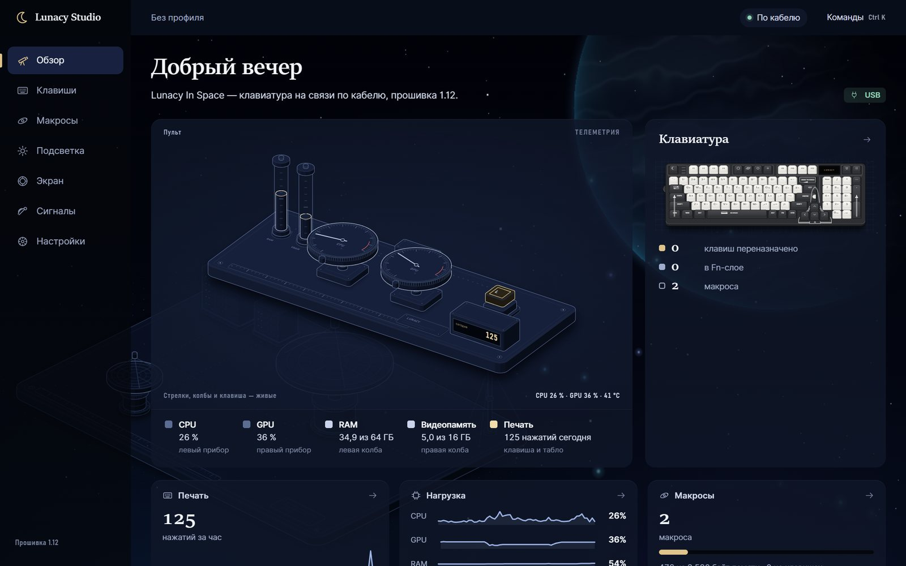
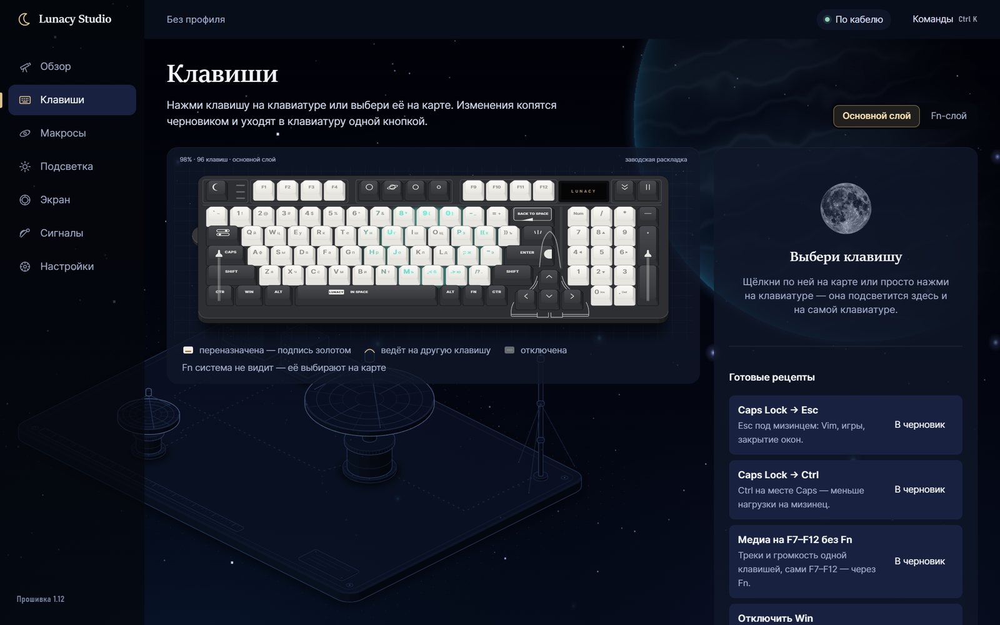
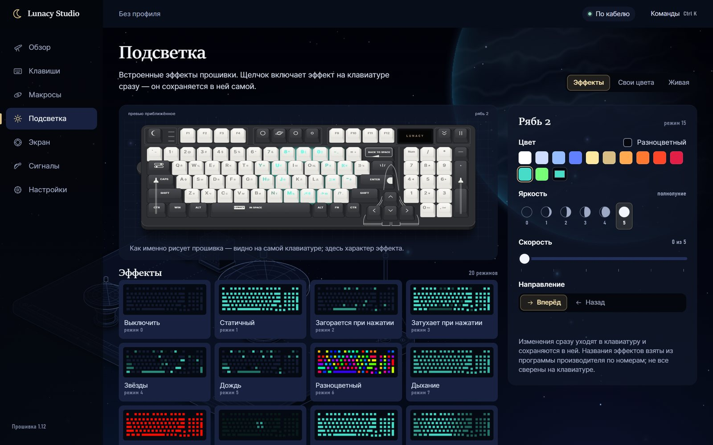
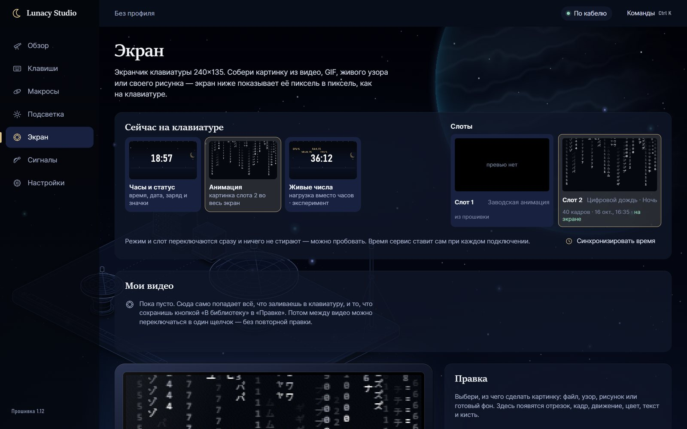
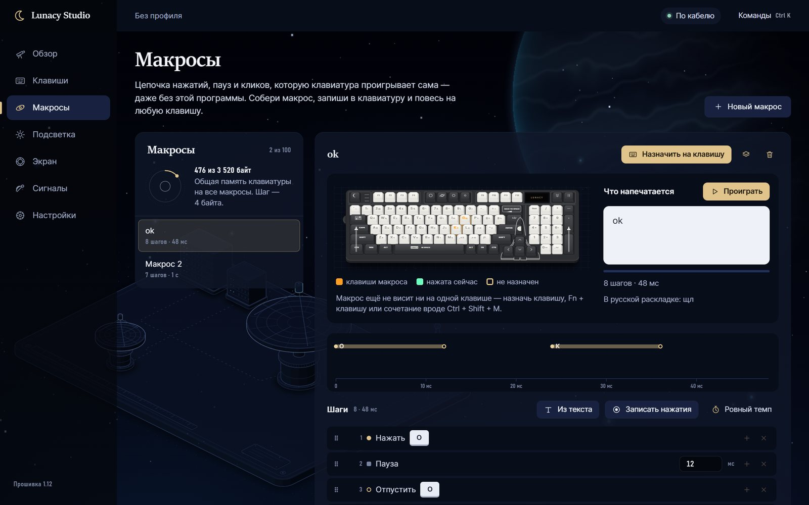

<p align="center"></p>

<h1 align="center">Lunacy Studio</h1>

<p align="center">Неофициальная программа для клавиатуры <b>Lunacy In Space</b>: клавиши, макросы, подсветка и экранчик — в одном окне.<br>
<a href="https://github.com/ninezeroshine/lunacy-studio/releases/latest"><b>Скачать для Windows</b></a> · <a href="README.en.md">English</a></p>



## Что умеет

- **Клавиши.** Переназначить любую клавишу в обычном слое и в слое Fn: другая клавиша, сочетание, мультимедиа, кнопка мыши, макрос или «отключить». Клавишу можно выбрать на картинке или просто нажать её. Готовые рецепты: Caps Lock → Esc, медиа на F-ряду без Fn и другие.
- **Макросы.** Записать нажатия с настоящей клавиатуры или набрать текст, поправить паузы, посмотреть, как макрос проиграется. Повесить его на клавишу, на Fn + клавишу или на сочетание вроде Ctrl + Shift + M.
- **Подсветка.** Все встроенные эффекты, свои цвета для каждой клавиши, живые режимы: подсказка горячих клавиш, смена раскладки, нагрузка компьютера, Ambilight.
- **Экранчик.** Залить своё видео, GIF или картинку, обрезать, поправить цвет, добавить текст или рисунок прямо в программе. Двенадцать анимированных узоров. Все залитые видео сохраняются в «Мои видео», между ними можно переключаться в один щелчок.
- **Сигналы.** Фокус-таймер на F-ряду, подсветка, когда Claude Code ждёт ответа, тепловая карта нажатий.
- **Профили.** Сохранить настройку целиком, перенести на другой компьютер, вернуть заводскую.

| | |
|---|---|
|  |  |
|  |  |

## Установка

1. Откройте [последний выпуск](https://github.com/ninezeroshine/lunacy-studio/releases/latest) и скачайте **LunacyStudio-Setup-…exe**.
2. Запустите его. Windows может показать синее окно «Windows защитила ваш компьютер»: у программы нет платной цифровой подписи. Нажмите **Подробнее → Выполнить в любом случае**.
3. Установщик ничего не спрашивает про права администратора и ставит программу только для вас. В конце можно сразу запустить Lunacy Studio.
4. Подключите клавиатуру **кабелем**, переключатель на клавиатуре — в среднее положение (USB). Через ресивер 2.4G и Bluetooth работает не всё: экранчик по радио не заливается.

Python и другие программы ставить не нужно, всё уже внутри. Нужна Windows 10 или 11 (64-бит).

Если не хотите ничего устанавливать, в выпуске есть **portable.zip**: распакуйте и запустите `LunacyStudio.exe`. Портативная версия не обновляется сама — она только подскажет, что вышла новая.

## Первый запуск

Программа открывается отдельным окном и живёт в трее (значок луны возле часов). Закрыли окно — сервис продолжает работать: подсветка, макросы на сочетаниях и сигналы не выключаются. Открыть окно снова — щелчок по значку в трее или ярлык в меню «Пуск».

Изменения клавиш и макросов сначала копятся черновиком: внизу появляется полоса **«Записать в клавиатуру»** (Ctrl + S). Подсветка, экран и настройки применяются сразу.

**Важно:** закройте фирменную программу производителя, если она запущена. Две программы одновременно мешают друг другу говорить с клавиатурой.

## Обновления

Раз в несколько часов программа спрашивает GitHub, вышла ли новая версия. Если вышла, в верхней строке появляется кнопка **«Обновление»**: в ней видно, что изменилось, и одна кнопка «Обновить». Программа сама скачает установщик, проверит его контрольную сумму, закроется и откроется уже новой версией. Профиль, макросы и «Мои видео» остаются.

Проверку можно выключить: «Настройки» → «Программа» → «Проверять обновления». Кроме этого запроса программа ничего в интернет не отправляет.

## Если что-то не так

| Что видно | Что сделать |
|---|---|
| «Клавиатура не подключена» | Кабель USB-C в клавиатуру, переключатель в среднем положении. Попробуйте другой порт без разветвителя. |
| «Клавиатура занята другой программой» | Закройте программу производителя Lunacy (и в трее тоже). |
| Окно не открывается | Найдите значок луны в трее и щёлкните по нему. Если значка нет — запустите Lunacy Studio из меню «Пуск». |
| Экранчик не заливается | Заливка идёт только по кабелю. Не отключайте клавиатуру, пока идёт полоса прогресса. |
| Макрос на сочетании не срабатывает | Сочетания ловит сама программа, она должна быть запущена (значок в трее). Для работы без программы повесьте макрос на клавишу или Fn + клавишу. |
| Что-то сломалось после записи | «Настройки» → «Профили» → «Применить» нужный профиль или «Сброс к заводскому». |

Журнал работы лежит в `%APPDATA%\LunacyStudio\studio.log` — приложите его к [сообщению о проблеме](https://github.com/ninezeroshine/lunacy-studio/issues/new/choose).

## Где хранятся данные

Всё ваше — в папке `%APPDATA%\LunacyStudio`: настройка, профили, «Мои видео», журнал. Обновление и удаление программы её не трогают. Чтобы начать с чистого листа, удалите эту папку при закрытой программе.

Удалить программу: «Параметры Windows» → «Приложения» → **Lunacy Studio** → «Удалить».

## Экспериментальное

В «Настройки» → «Программа» → **«Экспериментальные функции»** включаются свой набор графики экранчика (фон экрана статуса, значки) и режим «Живые числа» (нагрузка компьютера вместо часов). Обе функции перезаписывают заводскую графику во флеш-памяти клавиатуры, и вернуть заводскую нечем. Поэтому по умолчанию они выключены.

## Это неофициальная программа

Lunacy Studio сделана энтузиастами и не связана с производителем клавиатуры. Протокол клавиатуры восстановлен по наблюдению за обменом с ней, файлов производителя в программе нет. Программа работает так, как описано, но гарантий нет: см. [лицензию MIT](LICENSE). Сторонние компоненты и их лицензии — в [THIRD_PARTY_NOTICES.md](THIRD_PARTY_NOTICES.md).

## Для разработчиков

Программа — локальный сервис на Python (только стандартная библиотека) и интерфейс на обычных ES-модулях без сборки. Подробности устройства — в [docs/DEVELOPMENT.md](docs/DEVELOPMENT.md), выпуск новой версии — в [docs/RELEASING.md](docs/RELEASING.md).

```bash
git clone https://github.com/ninezeroshine/lunacy-studio
cd lunacy-studio
pythonw -I studio/main.py
```

Тесты без клавиатуры (на заглушке): `python -I tests/t12_graphics.py` и другие из `tests/`, список — в [docs/DEVELOPMENT.md](docs/DEVELOPMENT.md).
